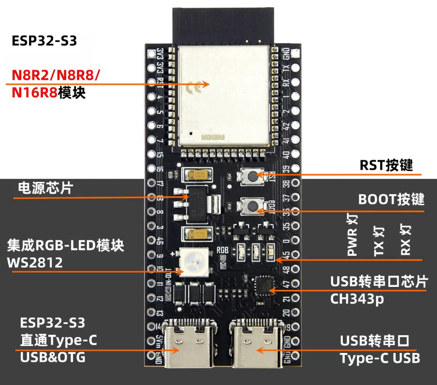

# ESP32-S3 CMSIS-DAP Debugger

基于 **ESP32-S3 + ESP-IDF** 的有线 / 无线 CMSIS-DAP 调试器固件。

支持 USB 有线调试、WiFi 远程调试、浏览器 Web 管理（串口 / 烧录）、虚拟 U 盘、CDC 串口桥接与 RGB 状态指示，可在 Keil、IAR、OpenOCD、PyOCD 等环境中作为 CMSIS-DAP 使用。

<p align="center">
  
</p>

<p align="center"><sub>参考硬件：ESP32-S3 开发板（双 Type-C：原生 USB&OTG / USB 转串口 CH343；板载 WS2812、BOOT、RST）</sub></p>

> 本仓库为开源 DIY / 学习用途固件，**不是**经认证的商业调试器。使用前请仔细阅读接线与安全说明，只验证过N8R8和N16R8这2个型号可以正常工作，其他型号可能需要改配置。

## 目录

- [功能特性](#功能特性)
- [系统架构](#系统架构)
- [烧录方式与理论速度](#烧录方式与理论速度)
- [硬件要求](#硬件要求)
- [Flash 分区与虚拟盘](#flash-分区与虚拟盘)
- [默认引脚](#默认引脚)
- [快速开始](#快速开始)
- [工作模式](#工作模式)
- [WiFi 配置](#wifi-配置)
- [有线调试](#有线调试)
- [无线调试](#无线调试)
- [Web 管理界面](#web-管理界面)
- [状态灯说明](#状态灯说明)
- [编译与烧录](#编译与烧录)
- [关键配置](#关键配置)
- [常见问题](#常见问题)
- [目录结构](#目录结构)
- [致谢](#致谢)
- [许可证](#许可证)
- [免责声明](#免责声明)

## 功能特性

| 功能 | 说明 |
|------|------|
| 有线调试 | USB CMSIS-DAP（WinUSB），可被 Keil / IAR / OpenOCD / PyOCD 等识别 |
| 无线调试 | WiFi STA + TCP **服务端**（默认端口 `3240`），配合 [elaphureLink](https://github.com/windowsair/elaphureLink) 等上位机 |
| Web 管理 | 无线联网后提供 HTTP 页面：Web 串口、烧录（盘内文件 / 浏览器上传） |
| 远程扩展 | 可将调试链路扩展到公网 IP / 内网穿透，实现异地烧录与在线调试 |
| USB 虚拟盘 | 有线模式 MSC 盘符（8MB 模组约 **5MB+**），可存放算法/程序、`wifi.ini` 等 |
| CDC 串口 | USB CDC ↔ UART 桥接，便于查看目标串口日志 |
| 模式切换 | 长按按键在有线 / 无线模式间切换 |
| 状态指示 | WS2812 显示模式与 WiFi 信号强度 |
| mDNS | 可选，默认主机名 `dap.local` |

默认工作在 **单接收端模式**（`SINGLE_MODE=1`）。

本方案的核心是「**TCP/IP ↔ CMSIS-DAP**」：局域网内可直接用设备 IP 连接；若为调试器分配公网可达地址（或经 VPN / 内网穿透转发 `3240` 端口），即可把同一套链路扩展为**远程烧录与远程调试**。同类思路在业界已有成熟产品形态，例如安富莱 **H7-TOOL** 等支持网络/远程调试的工具。

## 系统架构

```text
有线模式:
  PC ──USB──> ESP32-S3 (CMSIS-DAP / CDC / MSC) ──SWD/JTAG──> 目标 MCU

无线 / 远程模式:
  PC ──elaphureLink──TCP:3240──> (局域网 IP 或 公网/穿透) ──> ESP32-S3 ──SWD/JTAG──> 目标 MCU
  浏览器 ──HTTP:80──> 同一设备 IP（Web 串口 / 烧录页）
```

无线链路中：**上位机为 TCP Client，ESP32 为 TCP Server**。远程使用时，只需保证 Client 能访问到 Server 的 `IP:3240`。Web 管理走 **HTTP 80**，与调试端口独立。

## 烧录方式与理论速度

本固件对目标 MCU 的烧录都走 **SWD + Flash 算法（`.FLM`）**。下表为按实现推算的**理论量级**（非实验室标定保证值）；实际速度受目标 Flash 页大小/擦除时间、是否校验、线长、WiFi 信号、上位机设置等影响，可能差数倍。

| 烧录方式 | 链路 | SWD 时钟（理论） | 目标 Flash 编程吞吐（理论量级） | 说明 |
|----------|------|------------------|--------------------------------|------|
| **有线 CMSIS-DAP**（Keil / IAR / OpenOCD / PyOCD） | PC ──USB──> ESP32 ──SWD──> 目标 | 上位机可设；SWD 口走 **SPI 加速**，时钟请求较高时约 **10～40 MHz** 量级 | 常见约 **50～200 KB/s**；小容量 MCU、开校验时偏低 | 默认 SWJ 时钟配置为 1 MHz，Keil/IAR 里可提高；过高易失败，建议从 1～5 MHz 试起 |
| **无线 DAP**（elaphureLink 等，`TCP:3240`） | PC ──WiFi/TCP──> ESP32 ──SWD──> 目标 | 同有线（仍由上位机设 SWD 时钟） | 局域网良好时约 **20～100 KB/s**；弱网/穿透更低 | 瓶颈常在 WiFi/TCP 与 DAP 分包，一般慢于有线 USB |
| **Web 离线烧录**（`/program`，盘内文件） | 浏览器触发 → ESP32 读 `/data` → SWD 烧写 | 固件强制 **GPIO 位带**，`clock_delay=40`，偏慢稳妥（约 **百 kHz～1 MHz** 量级） | 约 **5～30 KB/s** | 不经 Keil；适合产线/现场点烧；整片擦除会额外耗时 |
| **Web 在线烧录**（`/program`，浏览器上传） | 浏览器 POST 固件 → ESP32 → SWD 烧写 | 与 Web 离线相同（GPIO 慢速） | SWD 段同离线；整体常受 **HTTP 上传** 限制，约 **5～25 KB/s** | 需先传完数据再烧；大文件更明显慢于离线 |
| **仅拷贝到 U 盘**（MSC） | PC ──USB MSC──> ESP32 Flash 文件系统 | —（不烧目标） | USB Full-Speed 理论约 **数百 KB/s～1 MB/s** 量级 | 只是把 `.FLM`/固件放到盘里，**不算**对目标 MCU 编程 |

### 速度相关说明

1. **SWD 时钟 ≠ 烧录速度**：时钟是调试口比特率；真正写 Flash 还要跑算法、擦除、写页、可选校验，吞吐远低于时钟名义值。  
2. **有线最快**：USB + SPI-SWD，适合日常 Keil 下载调试。  
3. **Web 故意偏慢**：离线/在线烧录使用较慢 GPIO SWD，优先兼容小芯片（如 PY32）与接线质量，不以极限速度为目标。  
4. **擦除模式影响体感时间**：扇区擦除随固件占用扇区增加；整片擦除固定多一段 ChipErase；选「不擦除」最快但需保证目标已空白或可覆盖。  
5. **对比参考**（量级，非承诺）：烧写约 **64 KB** 固件——有线常见数秒内；无线局域网十余秒级；Web 离线/在线可能数十秒级（含擦除时更长）。

## 硬件要求

- MCU：**ESP32-S3**（如 **S3N16R8 / R8N8**：8MB/16MB Flash + 8MB PSRAM）
- Flash：工程默认按 **8MB** 配置（见 [`partitions.csv`](partitions.csv)）
- 16MB Flash 模组可改用 [`partitions_16M.csv`](partitions_16M.csv)（storage 约 9MB），并在 `menuconfig` 中将 Flash size 设为 16MB
- 推荐板型：双 Type-C 开发板（一路 USB-UART / 一路原生 USB），板载 RGB、BOOT、RST
- 外围：模式按键（可用板载 **BOOT=GPIO0**）、WS2812（可用板载 **RGB=GPIO48**）、目标调试排针

已在 **ESP-IDF v5.1.x** 下验证；其他 5.x 版本理论兼容，请以实际编译结果为准。

> 有线 CMSIS-DAP / MSC 请优先使用 **原生 USB（USB）口**，不要只用 UART 下载口。

## Flash 分区与虚拟盘

默认 `USE_OTA=0`，8MB Flash 不再预留双 OTA 槽，把空间留给 USB 虚拟盘 / Web 文件存储：

| 分区 | 类型 | 大小（8MB 默认表） | 说明 |
|------|------|-------------------|------|
| factory | app | 2MB | 本固件（当前约 1.3MB，留有余量） |
| storage | FAT | **约 5.875MB（6016K）** | MSC 虚拟盘 + 无线 `/data`（算法、程序、`wifi.ini`） |
| nvs / otadata / phy | data | 较小 | 系统区 |

| 模组 Flash | 分区文件 | PC 可见盘符（约） |
|------------|----------|-------------------|
| **8MB**（S3R8N8 / N8R8） | [`partitions.csv`](partitions.csv) | **约 5MB+**（磨损均衡后略小于分区） |
| **16MB** | [`partitions_16M.csv`](partitions_16M.csv) | 约 9MB 量级 |

**注意：** 修改分区表或首次烧录建议整片擦除，否则 MSC 文件系统可能异常：

```bash
idf.py -p <PORT> erase-flash flash
```

烧录后按需编辑 `wifi.ini`，并将算法/程序放入 `algorithm/`、`program/`。

## 默认引脚

固件侧引脚集中定义在 [`main/include/hal_gpio.h`](main/include/hal_gpio.h)，可按板级原理图修改后重新编译。  
下表按 **按键 / RGB / USB / 串口 / 调试口** 分类，对应图示双 Type-C 开发板。

### 1. 按键

| 功能 | 板载丝印 | GPIO | 固件用途 | 说明 |
|------|----------|------|----------|------|
| 模式切换 | **BOOT** | **0** | `MODE_SWITCH_GPIO` | 内部上拉，**按下为低电平**；长按约 2s 切换有线/无线 |
| 复位 | **RST** | EN/CHIP_PU | 硬件复位 | 不占用固件 GPIO；短按复位芯片 |

> GPIO0 为 strapping 脚：**上电瞬间请勿按住 BOOT**，否则可能进入下载模式。正常运行后再长按即可切换模式。

### 2. RGB / 指示灯

| 功能 | 板载丝印 | GPIO | 固件宏 | 说明 |
|------|----------|------|--------|------|
| WS2812 状态灯 | **RGB** | **48** | `GPIO_LED_WIFI_STATUS` | 模式/WiFi 状态（橙/蓝/红/绿等） |
| DAP Running 灯 | — | **6** | `GPIO_LED_RUNNING_STATUS` | Target Running 指示（普通 GPIO 电平灯，可选外接；见下文点亮时机） |

### 3. USB

图示开发板有 **两个 Type-C**，用途不同：

| 接口（图示） | ESP32-S3 引脚 | 用途 |
|--------------|---------------|------|
| **ESP32-S3 直通 Type-C USB&OTG**（图左） | **D− = GPIO19，D+ = GPIO20**（芯片固定 USB PHY） | **有线 CMSIS-DAP / CDC / MSC 虚拟盘**（本固件主要使用） |
| **USB 转串口 Type-C**（图右，芯片 CH343） | 经 CH343 接到板载 `TX` / `RX` | `idf.py flash` / 串口监视器日志 |

> 使用有线调试功能时，请插 **直通 USB&OTG 口**。仅插 USB 转串口口一般只能下载固件、看 log，不会枚举 CMSIS-DAP。

### 4. 附带串口

| 功能 | GPIO | 固件宏 / 外设 | 说明 |
|------|------|---------------|------|
| 目标串口桥接 TX | **18** | `GPIO_UART_TX` / `UART_NUM_1` | USB CDC ↔ 目标板串口（发送） |
| 目标串口桥接 RX | **17** | `GPIO_UART_RX` / `UART_NUM_1` | USB CDC ↔ 目标板串口（接收） |
| 下载/日志 TX | **43** | 板载 `TX`（USB-UART） | 接 USB 转串口芯片，供烧录与 `idf.py monitor` |
| 下载/日志 RX | **44** | 板载 `RX`（USB-UART） | 接 USB 转串口芯片 |

说明：

- **GPIO17 / 18**：固件里的「附带调试串口」，接到**被测目标**的 UART，经 USB CDC 在电脑上打开。
- **GPIO43 / 44**：开发板自带下载串口，接到 **UART Type-C**，用于给 ESP32 烧录本固件、查看本机日志，**不是** SWD 目标口。

### 5. 调试接口（连接目标 MCU）

| 信号 | GPIO | 说明 |
|------|------|------|
| SWDIO | 11 | SWD 数据（必接） |
| SWCLK | 12 | SWD 时钟（必接） |
| nRESET | 13 | 目标复位（强烈建议） |
| TDO | 9 | JTAG |
| TDI | 10 | JTAG |
| nTRST | 14 | JTAG 测试复位 |

SWD 最少连接：**SWDIO、SWCLK、GND**。请保证目标供电正常，并与调试器**共地**。

### 引脚速查（固件默认）

```text
按键:     BOOT=GPIO0（模式切换）  RST=硬件复位
RGB:      GPIO48（WS2812）       GPIO6（Running LED，可选）
USB:      原生 USB = GPIO19/20   有线 DAP/CDC/MSC
串口:     UART1 TX/RX = GPIO18/17（接目标）
          板载 TX/RX = GPIO43/44（烧录/日志）
SWD:      SWDIO=11  SWCLK=12  nRESET=13
JTAG附加: TDO=9  TDI=10  nTRST=14
```

## 快速开始

1. 安装并激活 [ESP-IDF](https://docs.espressif.com/projects/esp-idf/zh_CN/latest/esp32s3/get-started/index.html)（推荐 5.1.x）
2. 进入本工程目录，配置目标并编译：

```bash
idf.py set-target esp32s3
idf.py build
```

3. 烧录（将端口替换为实际串口）：

```bash
# Linux / macOS
idf.py -p /dev/ttyUSB0 -b 460800 flash

# Windows
idf.py -p COMx -b 460800 flash
```

4. USB 连接电脑进入有线模式（默认蓝灯），用 Keil / IAR 等选择 **CMSIS-DAP + SWD** 调试目标
5. 如需无线：在虚拟 U 盘编辑 `wifi.ini`，长按按键切换到无线模式，再用上位机连接 `IP:3240`  
6. 联网后可用浏览器打开 `http://dap.local/` 或 `http://<IP>/`（Web 串口 / 烧录，见 [Web 管理界面](#web-管理界面)）

## 工作模式

| 项目 | 说明 |
|------|------|
| 默认模式 | 有线模式（`DEFAULT_DEBUG_MODE = WIRED_MODE`） |
| 切换方式 | 长按按键 ≥ 2s → 橙灯闪 2 次 → 软复位切换 |
| 有线模式 | 蓝灯；枚举 USB：DAP + CDC + MSC |
| 无线模式 | 按 WiFi 状态显示红 / 绿；监听 TCP 3240 |

模式会在重启后保持（由启动标志记忆）。

## WiFi 配置

### 优先：虚拟 U 盘 `wifi.ini`

1. 进入有线模式，打开电脑识别到的 U 盘  
2. 编辑根目录 `wifi.ini`（若不存在，固件会自动创建模板）：

```ini
# WiFi configuration for wireless mode
ssid=YourSSID1
password=YourPassword
```

3. **不要加引号**；密码键名也可用 `passwd=`  
4. 安全弹出 U 盘后，长按切换到无线模式  
5. 若文件不存在或 `ssid` 为空，则回退到固件内置列表

### 回退：固件内置列表

编辑 [`main/include/wifi_configuration.h`](main/include/wifi_configuration.h) 中的 `wifi_list[]`。

## 有线调试

1. USB 接入 PC（原生 USB&OTG 口），确认识别为 CMSIS-DAP  
2. IDE / 工具中选择 **CMSIS-DAP**，接口选择 **SWD**  
3. 接好 SWDIO / SWCLK / GND（建议接 nRESET）  
4. 推荐设置：  
   - Connect under Reset  
   - SWD 时钟先用 ≤ 1 MHz  
5. 若擦除失败并提示无法访问 `0xe000edf0`（DHCSR）：优先检查 nRESET、降时钟、Connect under Reset

### Keil MDK

1. Options for Target → **Debug** → 选择 **CMSIS-DAP Debugger**  
2. Settings → Port 选 **SW**，确认识别到本设备  
3. 按需在 Flash Download 中配置算法；SWD 时钟建议先 ≤ 1 MHz  

### IAR Embedded Workbench

1. Project → Options → **Debugger** → Driver 选 **CMSIS-DAP**  
2. **CMSIS-DAP** 分类页**Interface**中选 **SWD**（勿选 JTAG，除非目标确为 JTAG）  
3. 时钟/复位相关选项先用默认或较低速率；下载失败时勾选/使用复位后再连接类选项（Connect under reset，视 IAR 版本菜单文案而定）  
4. 确认 PC 设备管理器中已枚举本 CMSIS-DAP，再 Download / Debug  

> IAR 与 Keil 均通过标准 CMSIS-DAP 协议通信；Flash 加载算法由工程/芯片包提供，与本调试器固件无关。

## 无线调试

前提：`SINGLE_MODE=1`（默认已开启）。

1. 配置 WiFi（见上文）并切换到无线模式  
2. 确认灯为绿色（已联网）  
3. 上位机（如 [elaphureLink](https://github.com/windowsair/elaphureLink)）连接：

| 项 | 值 |
|----|-----|
| 角色 | ESP32 = Server，PC = Client |
| 端口 | `3240` |
| 地址 | 设备局域网 IP，或 `dap.local`（mDNS 开启时） |

### 远程烧录与调试（扩展）

固件本身已是 TCP 服务端，不一定局限于同一局域网：

1. 为现场 ESP32 提供可被上位机访问的地址（公网 IP、端口映射、VPN 或 frp/nps 等内网穿透）  
2. 将 `3240` 映射/转发到该设备  
3. 远端 PC 上用 elaphureLink 填写公网或穿透后的 `IP:3240`，即可进行烧录与调试  

这与安富莱 **H7-TOOL** 等产品「网络调试 / 远程维护」的应用场景类似，本仓库提供的是可二次开发的开源实现路径。公网暴露调试端口存在安全风险，建议配合 VPN、访问控制或临时隧道使用。

## Web 管理界面

无线模式且 **已获取 IP** 后，固件会启动内置 HTTP 服务（默认 **80** 端口）。用电脑/手机浏览器访问即可，无需额外安装上位机软件。

### 打开方式

1. 配置好 WiFi，长按切换到**无线模式**，RGB 呈绿色（已联网）  
2. 浏览器访问（任选其一）：

| 地址 | 说明 |
|------|------|
| `http://dap.local/` | mDNS 主机名（`USE_MDNS=1` 时） |
| `http://<设备IP>/` | 串口日志里 `Got IP: x.x.x.x` 的地址 |

常用页面：

| 路径 | 功能 |
|------|------|
| `/` 或 `/root` | 首页（Program / WebSerial 入口） |
| `/webserial` | Web 串口：浏览器 ↔ 目标 UART（WebSocket） |
| `/program` 或 `/program.html` | 烧录页：离线烧录 / 在线上传烧录 / 上传算法与程序 |

> 推荐访问 `http://dap.local/` 或 `http://<IP>/`，再从首页进入；勿用错误路径（旧固件曾对 `/program.html` 返回 404）。

### Web 串口（`/webserial`）

1. 将目标板 UART 接到本机 **GPIO18(TX) / GPIO17(RX)**（与目标共地）  
2. 打开 `/webserial`，连接后即可收发串口数据  
3. 可在页面中设置波特率（对应接口 `/api/set-baudrate`）

适用于现场看日志、简单 AT 交互，不依赖 USB CDC。

### 烧录页（`/program`）

烧录前请先接好目标 **SWD**（至少 SWDIO / SWCLK / GND，建议 nRESET）。

页面提供三类操作：

#### 1）盘内离线烧录（推荐配合 U 盘准备文件）

固件从设备 Flash 文件系统中读取算法与程序再烧录目标（**不经过 Keil**），但仍需通过本 Web 页点击「烧录」触发。

1. **准备文件（有线模式）**  
   - USB 进入有线模式，打开虚拟 U 盘  
   - 将 Flash 算法放入 `algorithm/`  
   - 将待烧固件（`.bin` / `.hex`）放入 `program/`  
   - 安全弹出后，切换到无线模式  
2. **浏览器打开** `/program`  
3. 选择：算法、程序；`.bin` 需填写 Flash 地址（十六进制）；按需填写 RAM 地址  
4. 点击 **离线烧录**，等待进度完成  

也可在烧录页用「上传算法 / 上传程序」把文件写到盘内，再选中后离线烧录。

#### 2）在线烧录

1. 在页面选择本机上的 `.bin` / `.hex`  
2. 选择算法，填写地址（`.bin` 必填 Flash 地址）  
3. 点击 **在线烧录**：浏览器把固件 POST 到设备，再由设备烧写目标  

适合临时烧一次，不必先拷进 U 盘。

#### 3）上传文件到盘内

- **上传程序** → 存到 `program/`  
- **上传算法** → 存到 `algorithm/`  

上传后可再走「盘内离线烧录」。单文件大小限制约 **10MB**（页面校验）。

### 使用注意

- Web 仅在**无线联网成功后**可用；有线 USB 模式一般不提供该页面  
- 盘内烧录仍需浏览器触发，**不是**「插盘断电后自动烧」；若需完全脱机按键自烧，需另行开发  
- 算法为 Keil **`.FLM`**（Flash Algorithm），须与目标芯片匹配；程序为 `.bin` / `.hex`  
- 无线模式会持久挂载 `/data`，上传算法/程序写入设备 Flash 文件系统（非浏览器临时缓存）  
- 与 elaphureLink 的 TCP `3240` 调试可同时存在：Web 用 80 端口，调试用 3240 端口  

### 安全提示（开源使用必读）

Web 管理面（串口 / 烧录 / 上传）与 TCP `3240` **默认无鉴权**，同一局域网内任意主机可访问。

- **仅在可信/隔离网络**使用；勿将设备直接暴露到公网  
- `wifi.ini` 为明文，请勿提交真实 SSID/密码到仓库  
- 上传与烧录接口已限制文件名字符集并禁止 `..` 路径穿越；文件名请使用字母、数字、`.` `_` `-`  
- 单文件上传/在线烧录上限约 **10MB**  

## 状态灯说明

### WS2812（GPIO48）

| 颜色 / 效果 | 含义 |
|-------------|------|
| 橙色呼吸 | 上电初始化 |
| 橙色闪 2 次 | 正在切换模式 |
| 蓝色常亮 | 有线模式正常 |
| 蓝色快闪（有线） | MSC 挂载失败 |
| 红色常亮（无线） | WiFi 未连接 |
| 绿色常亮 | WiFi 已连接，RSSI > -70 |
| 绿色慢闪 | WiFi 已连接，RSSI -70 ~ -80 |
| 绿色呼吸 | WiFi 已连接，RSSI ≤ -80 |
| 熄灭 | 无线指示任务结束 |

### DAP Running 灯（GPIO6）

板载开发板通常**没有**此灯，需在 GPIO6 外接普通 LED（高电平点亮）。由上位机通过 CMSIS-DAP 的 **Target Running** 命令控制，与 WS2812 无关。

| 状态 | 时机 |
|------|------|
| **点亮** | 调试器使目标 MCU **进入运行**（开始执行程序，如 Keil 点 Run / 全速运行） |
| **熄灭** | 目标 **停止运行**（Halt、断点停住、复位停住等）；上电初始化时默认为灭 |

说明：是否点亮取决于上位机是否下发 Running LED 命令；部分工具/场景可能不驱动该指示，属正常现象。

## 编译与烧录

```bash
idf.py set-target esp32s3
idf.py build
# 首次或分区表有变更时建议整片擦除再烧（会清空 MSC 盘内文件）
idf.py -p <PORT> erase-flash flash
# 仅更新应用、分区未变时可：
# idf.py -p <PORT> -b 460800 flash
idf.py -p <PORT> monitor   # 可选：查看日志
```

- 组件依赖见 `main/idf_component.yml`。有网时由组件管理器拉取到 `managed_components/`  
- 若本机已有完整 `managed_components/`，工程会自动离线编译（`IDF_COMPONENT_MANAGER=0`），避免连不上组件仓库时报错  
- 首次使用或组件校验异常时，可删除 `managed_components/*/.component_hash` 后重新 `idf.py build`

## 关键配置

| 文件 | 作用 |
|------|------|
| [`main/include/hal_gpio.h`](main/include/hal_gpio.h) | 引脚定义 |
| [`main/include/dap_configuration.h`](main/include/dap_configuration.h) | 有线/无线、`SINGLE_MODE`、长按时间 |
| [`main/include/wifi_configuration.h`](main/include/wifi_configuration.h) | WiFi 列表、端口、mDNS |
| [`partitions.csv`](partitions.csv) | 默认 8MB 分区表（factory 2MB + storage ≈5.875MB） |
| [`partitions_16M.csv`](partitions_16M.csv) | 16MB Flash 可选分区表（storage 约 9MB） |

`SINGLE_MODE=0` 为「发送端 + 接收端」双机架构，ESP32 会主动连接固定 IP，**一般单板用户请保持为 1**。

## 常见问题

**能识别调试器，但无法下载 / 全片擦除失败（`0xe000edf0`）？**  
检查 SWD 接线、共地、目标供电；降低 SWD 时钟（≤1MHz）；连接 nRESET 并启用 Connect under Reset。本固件 nRESET 仅做硬件复位。

**U 盘容量不对 / 打不开？**  
确认 Flash 为 8MB 且使用 [`partitions.csv`](partitions.csv)；执行 `erase-flash flash` 后重试，8MB 模组可见约 **5MB+**。

**无线出现 `Socket connect failed errno=113`？**  
确认 `SINGLE_MODE` 为 `1`。为 `0` 时固件作为客户端去连固定 IP，容易报主机不可达（`EHOSTUNREACH`）。

**修改 `wifi.ini` 后不生效？**  
需安全弹出 U 盘后再切到无线模式；`ssid` 不能为空；不要使用引号。

**按键无反应？**  
确认接到 GPIO0，按下为低电平；上电瞬间不要按住。

**打不开 Web 页面？**  
确认已处于无线模式且 RGB 为绿色；用 `dap.local` 或日志中的 IP；电脑需与设备同一网段；烧录页地址为 `/program`。

**编译报 `Cannot establish a connection to the component registry`？**  
检查网络/DNS；或保留已下载的 `managed_components/` 后离线编译（工程已支持）。

## 目录结构

```text
.
├── main/                 # 应用层：USB / WiFi / 按键 / LED / DAP 任务
├── components/           # DAP、Program、USBIP、elaphureLink、webServer 等
├── html/                 # Web 页面：root / webserial / program
├── managed_components/   # IDF 组件管理器依赖（构建时拉取；可本地离线复用）
├── docs/
│   └── esp32s3-board.png # 参考开发板图片
├── partitions.csv        # 默认 8MB 分区表（storage ≈5.875MB）
├── partitions_16M.csv    # 16MB Flash 可选分区表
├── LICENSE               # Apache License 2.0
└── README.md             # 本说明（仓库主页）
```

## 致谢

本项目站在诸多开源工作之上，包括但不限于：

- [ARM CMSIS-DAP](https://github.com/ARM-software/CMSIS-DAP) 调试协议实现思路  
- [windowsair / ESP32 相关 DAP / usbip 生态](https://github.com/windowsair)  
- [elaphureLink](https://github.com/windowsair/elaphureLink) 无线调试上位链路  
- [Espressif ESP-IDF](https://github.com/espressif/esp-idf)、TinyUSB、led_strip、mDNS 等组件  

若致谢列表有遗漏或链接需更正，欢迎提 Issue / PR。

## 许可证

本仓库代码以 **Apache License 2.0** 发布，详见 [`LICENSE`](LICENSE)。

第三方组件（CMSIS-DAP、TinyUSB、ESP-IDF 组件等）遵循其各自许可证，使用时请一并遵守。

## 免责声明

- 本固件仅供学习、研究与 DIY 使用。  
- 错误接线、电平不匹配或误操作可能导致目标板或调试器损坏，请自行评估风险。  
- 作者与贡献者不对使用本软件造成的任何直接或间接损失承担责任。  
- 公开仓库前请自行检查是否包含私人 WiFi 密码、证书或其他敏感信息。
